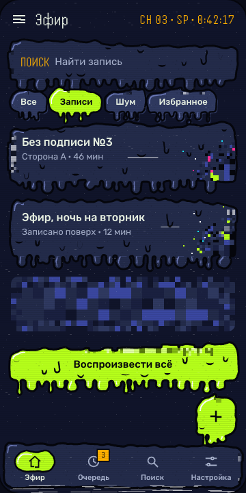
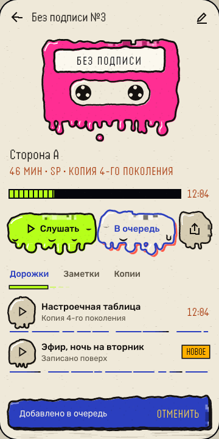

# mutant-ui

A Compose Multiplatform UI kit in the look of a damaged copy: grime, glitch and VHS. Every component stands on a
generated slime body, with drips, compression mosaic and flow lines under clean text, icons and touch targets, and tape
noise runs over the screen. The same instance is damaged the same way on every launch and every platform. There is no
Material dependency.

<p>
  
  &nbsp;
  
</p>

*Both pictures are the kit's own screenshot goldens, so they show what the code at this commit draws.*

**[Try it in the browser →](https://youndie.github.io/mutant-ui/)** Every component on one page, both palettes,
reduce motion, the clean signal and the demo screens.

## What is in it

| Group | Components |
|---|---|
| Actions | `MutantButton`, `MutantOutlinedButton`, `MutantTextButton`, `MutantIconButton`, `MutantFab`, `MutantExtendedFab`, `MutantSegmentedButton` |
| Selection and input | `MutantCheckbox`, `MutantRadioButton`, `MutantSwitch`, `MutantSlider`, `MutantChip`, `MutantTextField`, `MutantSearchBar`, `MutantDatePicker`, `MutantTimePicker` |
| Containment | `MutantCard`, `MutantListItem`, `MutantDivider`, `MutantCarousel`, `MutantDataTable` |
| Navigation | `MutantTopAppBar`, `MutantTabs`, `MutantNavigationBar`, `MutantNavigationDrawer`, `MutantMenu`, `MutantDropdown` |
| Communication | `MutantBadge`, `MutantLinearProgress`, `MutantCircularProgress`, `MutantCocoon` (loading), `MutantSnackbar`, `MutantTooltipBox`, `MutantEmptyState`, `MutantPullToRefresh` |
| Overlays | `MutantDialog`, `MutantBottomSheet` |
| Appearing | `MutantAppear` (its content tunes in through a 16 dp and an 8 dp mosaic, and steps out through the 8 dp one), `MutantScreen` (a content slot keyed by the screen: a new screen tunes in as the pill, the tabs' bar or the chip that chose it starts to move, and the old one goes in one frame) |
| Screen effects | `Modifier.mutantTape()` (the tape noise), `MutantKeyframeLoss` (a band of the picture that breaks and drags every nine seconds), `Modifier.mutantPattern()`, `MutantIllustration`, `MutantIcon` |

## Using it

```kotlin
repositories {
    maven("https://reposilite.kotlin.website/snapshots") {
        mavenContent { includeGroupAndSubgroups("io.github.youndie") }
    }
}

dependencies {
    implementation("io.github.youndie:mutant-core:0.1.0.<build>")
}
```

Every push to `main` publishes `<head>.<build>`, where the head names the next release; the latest build is the last
`<version>` in
[maven-metadata.xml](https://reposilite.kotlin.website/snapshots/io/github/youndie/mutant-core/maven-metadata.xml).
There is no release yet.

```kotlin
MutantTheme {
    Box(Modifier.fillMaxSize().background(MutantTheme.colors.background).mutantTape()) {
        MutantButton("Play", onClick = {})
    }
}
```

Put the Tape once on a screen's root, not on each component.

### The theme's switches

| Parameter | Default | What it does |
|---|---|---|
| `colors` | `MutantPalettes.Efir` | the palette: `Efir` (dark) or `Kopiya` (light) |
| `cassette` | the kit's | the seed every body's damage is drawn from; the same seed, the same damage |
| `reduceMotion` | the platform's setting | pauses the clock: the damage stays, nothing moves, toggles land at once |
| `cleanSignal` | `false` | «Чистый сигнал», for long sessions and those sensitive to flicker: no Tape, no keyframe loss, no idle glitches; the bodies keep their shapes and the clock runs. Offer it to the user as a switch |
| `steppedMotion` | `false` | movement steps on the design's tick, eight times a second, as the design draws it, instead of on every frame |
| `mosaicPastContour` | `false` | an experiment: the edge mosaic's blocks cross the outline and stand outside the body ([B-137](docs/backlog/B-137-mosaic-past-the-contour.md)) |

One clock drives a screen. Where an app shows several screens at once, wrap each in `MutantScreenClock`, so a dialog
opened in one holds only that one.

## Platforms

Targets: desktop (JVM), Android, iOS (arm64 and the arm64 simulator) and wasm in the browser.

| Where | Run it | How it runs |
|---|---|---|
| Desktop | `./gradlew :sample:run` | 60 frames a second on the resting Components page, 2.8 ms of work a frame ([B-138](docs/backlog/B-138-a-round-on-every-platform.md)) |
| Browser | [the site](https://youndie.github.io/mutant-ui/), or `./gradlew :sample:wasmJsBrowserDistribution` and serve its output | 59 f/s in Chrome on a Mac. On a Pixel 6a about 50 f/s at 7–8 ms ([B-141](docs/backlog/B-141-the-tape-draws-in-a-layer-of-its-own.md)), but one second in nine drops to 8–20 f/s while a keyframe loss runs ([B-145](docs/backlog/B-145-the-keyframe-losss-steps-off-the-slow-path.md), open) |
| Android | `bench-android` (a measuring host, not a sample) | 60 f/s natively on a Pixel 6a for ten cards ([B-138](docs/backlog/B-138-a-round-on-every-platform.md)) |
| iOS | `scripts/sim-bench.sh bundle`, then `scripts/sim-bench.sh show` (the simulator; no Xcode project) | 57 f/s on the Components page in the simulator, a Mac's numbers, not a phone's ([B-138](docs/backlog/B-138-a-round-on-every-platform.md)); the sample sits under the status bar ([B-139](docs/backlog/B-139-the-sample-under-the-status-bar-on-ios.md), open) |

## How it is kept honest

The design is a Claude Design project with an executable generator, frozen in
[`reference/design-system/`](reference/design-system/) on 2026-11-13. Since 2026-11-16 the code is primary and the
design records where the kit started ([research D20](docs/research/research-architecture.md)); a departure from it is
named in the check it moves.

- **The bodies** come from the design's own generator, ported to common Kotlin stream for stream and rounding for
  rounding, and held to it by numeric goldens taken from the engine.
- **The components** are held in pixels to references rendered from the design's pages in headless Chrome, against a
  measured floor, and by screenshot goldens of every state.
- **Behaviour** — focus, keyboard, touch targets of at least 48 dp, reduce motion, right to left, font scale, overlays — by
  tests on the desktop JVM.
- **Frame cost** is measured on the platforms above with a known cost planted as a control in every run; the logs stay
  under [`logs/`](logs/README.md).

## Building it

The gates run on a Mac, where the goldens were recorded:

```bash
make check        # the documentation gate and the design's golden
```

```bash
./gradlew check   # tests, ktlint, screenshot goldens, ABI
```

The public API is pinned in [`mutant-core/api/`](mutant-core/api/). Every change is a backlog item on its own branch,
merged when both gates pass on its last commit.

## Where things are

| | |
|---|---|
| [`mutant-core/`](mutant-core/) | the library |
| [`sample/`](sample/) | the sample: every component and the demo screens, desktop, browser and the iOS simulator |
| [`bench-android/`](bench-android/) | the Android host for frame measurements |
| [`reference/design-system/`](reference/design-system/) | the design, frozen |
| [`backlog.md`](backlog.md) | the order of work; one file per item in [`docs/backlog/`](docs/backlog/) |
| [`docs/`](docs/README.md) | the documentation: [why it is built this way](docs/research/research-architecture.md), [the module](docs/services/mutant-core.md) |
| [`logs/`](logs/README.md) | the raw logs behind every measured claim |
| [`scripts/`](scripts/) | references, goldens, tokens, icons and the frame benches |

## Licence

MIT. The bundled fonts, Handjet and Rubik, keep their OFL.
